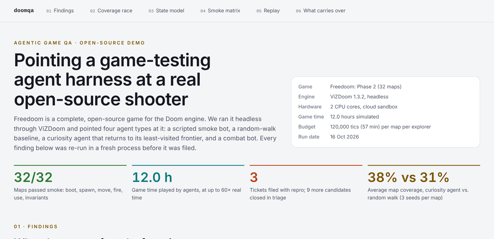
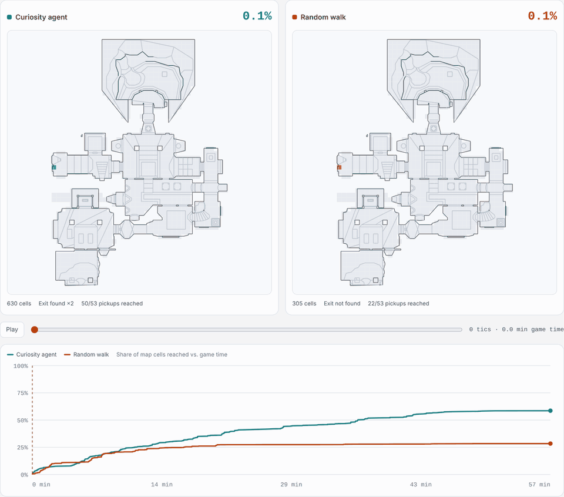
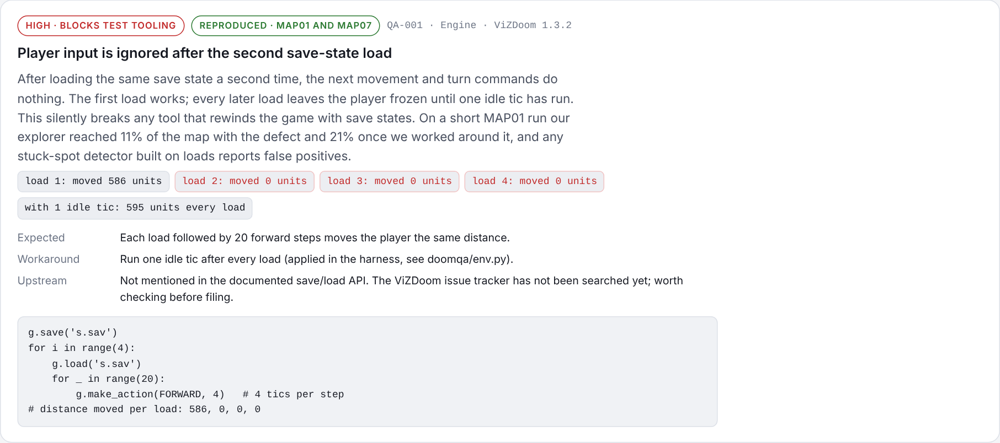
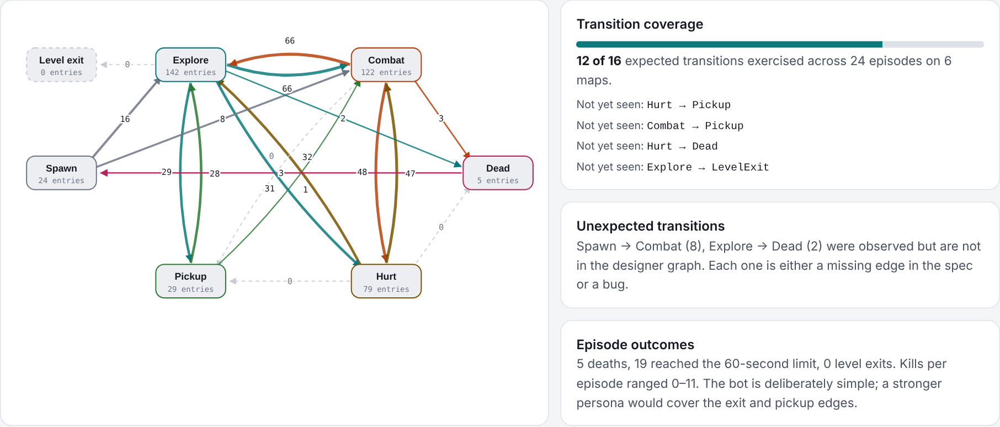
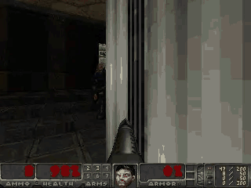

# doomqa

**Agent-based end-to-end testing, pointed at a real open-source shooter.** Four kinds of bots play
[Freedoom: Phase 2](https://freedoom.github.io/) headless in [ViZDoom](https://vizdoom.farama.org/) 1.3.2.
Every finding is re-run in a fresh game process before it becomes a ticket.

**[Open the interactive report →](https://YOUR-USERNAME.github.io/YOUR-REPO/)**  ·  PDF: [dark](docs/freedoom-qa-report-dark.pdf) / [light](docs/freedoom-qa-report-light.pdf)

<picture>
  <source media="(prefers-color-scheme: dark)" srcset="docs/media/hero-dark.png">
  
</picture>

## Results

| | |
|---|---|
| Smoke checks | **32 / 32** maps boot, spawn, move, fire, use and hold invariants |
| Game time played | **≈ 12 hours** on 2 CPU cores |
| Tickets | **3 filed**, each with a repro; **9 candidates closed** in triage (8 test artifacts, 1 bug in our own checks) |
| Coverage, mean of 3 seeds | curiosity agent **38%** vs random walk **31%** (120,000 tics per map) |

### The coverage race

Teal is the curiosity agent (Go-Explore style: it returns to its least-visited map cells through save states). Rust is a random walk with the same action style and budget.

<picture>
  <source media="(prefers-color-scheme: dark)" srcset="docs/media/coverage-race-dark.gif">
  
</picture>

| Map | Curiosity | Random | Difference |
|---|---:|---:|---:|
| MAP01 | 61.9% | 35.7% | **+26.2** |
| MAP02 | 64.4% | 50.0% | **+14.4** |
| MAP03 | 14.6% | 19.0% | −4.4 |
| MAP04 | 38.9% | 41.1% | −2.2 |
| MAP05 | 28.1% | 22.9% | **+5.1** |
| MAP06 | 19.2% | 19.3% | −0.1 |

MAP06 hits the same ceiling in every run for both agents: the rest of the level sits behind a key or switch neither agent finds. That calls for a goal-seeking agent, not more exploration time.

### Tickets

<picture>
  <source media="(prefers-color-scheme: dark)" srcset="docs/media/ticket-qa001-dark.png">
  
</picture>

1. **QA-001, ViZDoom engine:** after the second `load()` of a save state, player input is ignored until one idle tic runs. Movement after loads 1–4 was 586, 0, 0 and 0 units; with an idle tic it was 595 every time. The workaround is in `doomqa/env.py`.
2. **QA-002, ViZDoom engine:** a loaded save state is not bit-identical to the live game (about 0.03 units of drift over 60 steps), so runs that used save states can't be rebuilt from input logs.
3. **QA-003, test design:** the same seed and inputs gave different fights (health 90, 82, 92). Engine demos replayed exactly in 24/24 combat episodes, so tickets carry a demo, or a save plus inputs.

### State-transition coverage

<picture>
  <source media="(prefers-color-scheme: dark)" srcset="docs/media/states-dark.png">
  
</picture>

### Replayed from a recorded demo



This isn't a screen recording. The engine re-simulates the run from the demo file the bot wrote while playing.

## Layout

| Path | What it is |
|---|---|
| `doomqa/env.py` | Game setup, buttons, discrete actions, state read-out, `load()` with the QA-001 workaround |
| `doomqa/geometry.py` | Map geometry from sector data: wall segments, walkable cells, sectors under the player's footprint |
| `doomqa/checks.py` | Per-step invariants and the player-state classifier with the expected transition graph |
| `doomqa/agents.py` | Smoke bot, random walk, curiosity agent, combat bot, stuck probe, escape test, fresh-process replay |
| `doomqa/determinism.py` | Input replay vs. demo replay, repeated loads, save fidelity |
| `run_all.py` | Main campaign: smoke on 32 maps, combat on 6, both explorers on 6, replay of every finding |
| `seeds.py` | Two extra seeds per map and explorer |
| `triage_stuck.py` | Nearby-monster check and re-probe for stuck candidates |
| `verify_demos.py` | Replays every combat demo and compares kills, items and damage with the live run |
| `perf_serial.py` | Throughput per map, one map at a time |
| `clip.py` | Renders an animated clip from a recorded demo |
| `report/` | `build_report.py` and `template.html`, which produce the report page |
| `out/` | Raw results (JSON), demos (`demos/*.lmp`), repro save states (`repro/*.sav`), screenshots |

## Run it

```bash
pip install -r requirements.txt     # ViZDoom ships with Freedoom
python3 run_all.py                  # ~30 min on 2 cores
python3 seeds.py                    # optional, ~40 min
python3 triage_stuck.py
python3 verify_demos.py
python3 perf_serial.py
python3 clip.py MAP03 out/demos/MAP03_combat_ep1.lmp out/clip.webp 21 18
python3 report/build_report.py      # writes report/index.html
mv report/index.html docs/index.html   # GitHub Pages serves docs/
```

To run only some jobs, pass their kinds: `python3 run_all.py smoke combat`. The kinds are `det`, `smoke`, `combat`, `goexplore` and `random`.

## Reproducing a finding

Exploration findings ship as a save state plus the inputs that followed it:

```python
from doomqa.env import make_game, start_episode, load, ACTIONS, ACTION_NAMES, FRAME_SKIP
g = make_game('MAP04', god=True); start_episode(g)
load(g, 'out/repro/MAP04-random-001_start.sav')
for a in finding['repro']['inputs']:
    g.make_action(ACTIONS[ACTION_NAMES[a]], FRAME_SKIP)
```

Combat episodes are engine demos: `game.replay_episode('out/demos/MAP02_combat_ep1.lmp')`.

## Things worth knowing about ViZDoom

- Always load through `env.load()`, which runs the idle tic that QA-001 needs.
- `TURN_LEFT_RIGHT_DELTA` takes effect a tic late, so an immediate read shows no turn. Turn with the turn buttons and check the angle (`agents._turn_by`).
- In god mode, monsters can pin the player indefinitely. Run navigation coverage with monsters ignoring the player, and keep monsters for the combat bot.

## Prior work

- Ecoffet et al., "First return, then explore", *Nature* 2021 (Go-Explore).
- Gordillo, Bergdahl, Tollmar and Gisslén, "Improving Playtesting Coverage via Curiosity Driven Reinforcement Learning Agents", IEEE CoG 2021 ([arXiv 2103.13798](https://arxiv.org/abs/2103.13798)).
- Taesiri et al., "GlitchBench", CVPR 2024 ([arXiv 2312.05291](https://arxiv.org/abs/2312.05291)).

## Third-party content

See [`THIRD_PARTY.md`](THIRD_PARTY.md). Freedoom and ViZDoom are separate projects with their own licenses; they are installed from PyPI and not vendored here.
